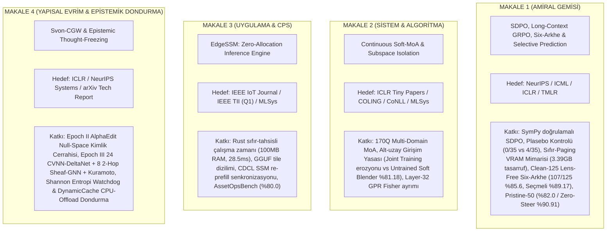

# SODALS Dörtlü Makale Portföy Stratejisi (Four-Paper Portfolio Strategy)
## Akademik Ayrıştırma, Hedef Dergi/Konferanslar ve Yayın Yol Haritası

**Tarih:** 19 Kasım 2026  
**Yazar:** Burak Öztürk & SODALS AI Research Group  
**Amaç:** Tek bir mega-makale ("kitchen-sink paper") yerine, her biri tek bir spesifik bilimsel problemi derinlemesine çözen, yöntemleri ve deneyleri su geçirmez **dört bağımsız akademik yayının** planlanması.

---

## Genel Bakış: 4 Makalenin Konumlandırma Matrisi

---

## 1. MAKALE 1: SDPO, Long-Context GRPO ve Sürekli Manifold Regülasyonu (Amiral Gemisi)

- **Tam Başlık:** *Self-Distillation Policy Optimization (SDPO), Long-Context GRPO, and Continuous Manifold Stabilization in Frontier Reasoning*
- **Ana Dosya:** [arxiv/arXiv_SODALS_v2.1_Master_Paper.md](file:///c:/Users/Burak/Desktop/sodals_core/arxiv/arXiv_SODALS_v2.1_Master_Paper.md)
- **Durum:** **Makale taslağı tamamlandı; SDPO plasebo kontrolü, sıfır-paging VRAM mimarisi, 1536-token GRPO eğitimi ve Pondering ODE doğrulamaları eklendi.**

### Bilimsel Problem ve Hipotez:
- *Problem:* (1) LLM'lerde kendi kendini düzeltme (self-correction) eğitiminin gerçekten nedensel bir öğrenme refleksi mi yarattığı yoksa rastgele ağırlık oynaması mı olduğu; (2) Tüketici sınıfı donanımda (8GB VRAM) uzun akıl yürütme pencerelerinin ($L=1536\text{--}2048$) WDDM sürücü paging cezası olmadan açılıp açılamayacağı; (3) Takviyeli öğrenmenin (RL) SFT tavanını katastrofik unutma olmadan aşıp aşamayacağı.
- *Hipotez:* SymPy doğrulamalı yörüngelerle SDPO eğitimi nedensel hata onarım refleksi sağlar; CPU embedding offload + NF4 head kuantizasyonu + chunked policy loss ile VRAM tabanı 7,298 MB'tan 3,907 MB'a (-3.39 GB) indirilerek 8GB GPU'da sıfır paging ile 1536-token GRPO çalıştırılabilir; üstüne Lens-Free Six-Arkhe ($G=4$) ve Seçmeli Çekimserlik ($\tau=0.20$) ile kesin halüsinasyon azaltımı elde edilir.

### Ana Deneysel Bulgular:
1. **Negatif Plasebo Kontrolü:** 17 adımlık plasebo modeli görülemeyen 35 sınır sorusunda **0 / 35 (%0.0)** düzeltme yaparken, Saf SDPO **4 / 35 (%11.4)** net düzeltme sağlamıştır (iki yönlü Fisher $p = 0.114$, tek yönlü $p = 0.057$, McNemar $p \approx 0.125$; $N=35$ sınırlı güçtedir, $N \ge 100$ hedeflenmektedir).
2. **$F_4$ Anomalisi ve Factual Anchor Takası:** $F_4=52$ bilgisini korumak için 3 adet alan anchor'ı eklendiğinde (SDPO-A), $F_4=52$ başarıyla korunmuş (21/24, %87.5) ancak held-out hata kurtarma oranı **4/35'ten 2/35'e (%5.71)** düşmüştür (Pareto kapasite takası).
3. **Sıfır-Paging VRAM Mimarisi (3.39 GB / 3,391 MB Tasarruf):** Host CPU embedding aktarımı (-1,645 MB), 4-bit NF4 LM Head (-1,431 MB) ve Chunked Policy Loss ($chunk\_size=32$, logit belleği 15.8 MB) ile model tabanı 7,298 MB'tan 3,907 MB'a çekilmiş; $L=2048$ token ileri+geri yayılımında 0 WDDM paging ile 1,822 MB serbest fiziksel alan korunmuştur (Rollout hızı: 58.57 tok/s).
4. **1536-Token GRPO Pilotu (Temiz Held-Out Dürüst Değerlendirme) & Lens-Free Six-Arkhe:** 25 promptluk ($G=4$) GRPO pilotu, 25 eğitim sorusu ayrıştırıldıktan sonra **Clean-125** üzerinde tekil bir iyileşme (`Q105`, 99→100/125 legacy, 103→104/125 NormSym, 0 kayıp, McNemar $p=1.0000$ — istatistiksel olarak anlamlı bir SFT tavan aşımı değil, sıfır-regresyon pilot kanıtı) sağlamıştır. Asıl sıçrama **Lens-Free Six-Arkhe ($G=4$)** ve **Seçmeli Çekimserlik** ile gelmiştir: Clean-125 **107/125 (%85.60)** zorunlu / **107/120 (%89.17)** seçmeli (%96 kapsama, 5/5 halüsinasyon kesimi); Pristine-50 Always-On **41/50 (%82.00)** zorunlu / Zero-Steer **40/44 (%90.91)** seçmeli (%88 kapsama).
5. **Prefill Pondering ODE (RK4 Manifold Regülasyonu):** 4. derece Runge-Kutta sürekli manifold gevşetmesi, Clean-125'te 100/125 legacy (104/125 NormSym) skorunu 0 kazanç / 0 kayıpla koruyan **nötr değişmezlik (null result)** operatörü olarak belgelenmiştir.

### Hedef Mecralar:
- **Konferanslar:** NeurIPS / ICML / ICLR / ACL.
- **Dergi:** Transactions on Machine Learning Research (TMLR).

---

## 2. MAKALE 2: Tüketici Donanımında Continuous Soft-MoA & Alt-Uzay İzolasyonu (Sistem/Algoritma)

- **Tam Başlık:** *Learned Continuous Soft Mixture of Low-Rank Adapters for Multi-Domain Fine-Tuning on Constrained Hardware*
- **Ana Dosya:** [arxiv/arXiv_SODALS_v2.1_Soft_MoA_Paper.md](file:///c:/Users/Burak/Desktop/sodals_core/arxiv/arXiv_SODALS_v2.1_Soft_MoA_Paper.md)
- **Çekirdek Kodlar:** [sft/gpr_differentiable_gate.py](file:///c:/Users/Burak/Desktop/sodals_core/sft/gpr_differentiable_gate.py), [sft/soft_lora_blender.py](file:///c:/Users/Burak/Desktop/sodals_core/sft/soft_lora_blender.py), [sft/eval_soft_moa_170.py](file:///c:/Users/Burak/Desktop/sodals_core/sft/eval_soft_moa_170.py)
- **Durum:** **Makale taslağı tamamlandı; 170-soruluk çok alanlı ablasyon tamamlandı; alt-uzay girişim etkisi (Subspace Interference Effect) ampirik olarak kanıtlandı ve donduruldu.**

### Bilimsel Problem ve Hipotez:
- *Problem:* 8GB VRAM'e sahip tüketici donanımında birden fazla alana (Genel STEM ve Soyut Cebir) ait LoRA adaptörlerinin ortak eğitilmesi çapraz kovaryans ($A_1 A_2^T \neq 0$) nedeniyle katastrofik girişime yol açar.
- *Hipotez:* Katman 32 latent aktivasyonlarından beslenen GPR yönlendiricisi ve sürekli harmanlayıcı ($\Delta W = (1-\alpha)s_1 W_1 + \alpha s_2 W_2$), adaptörleri eğitimde kesin olarak izole tutup yalnızca çıkarım anında harmanlayarak en yüksek doğruluğu sağlar.

### Ana Mühendislik ve Deneysel Katkılar:
1. **170-Soruluk Çoklu Alan Doğrulaması:** 150 MATH-500 + 20 Soyut Cebir sorusunda Eğitimsiz Soft Blender **138 / 170 (%81.18)** ile zirve skoru vermiştir.
2. **Ortak Eğitimin Çöküşü (Subspace Interference Law):** Uçtan uca ortak eğitim (Faz 3 Ham: 128/170, Faz 3 Optimize: 135/170, Faz 13 Warm-Start: 137/170) yapıldığında modelin ilk kez çözdüğü $E_7=133$ Lie boyutu silinmiş (`70`), $\mathfrak{sp}(6)=21$ bozulmuş (`1`) ve net gerileme yaşanmıştır.
3. **Üretim Standardı:** Adaptörlerin izole eğitilip çıkarım anında GPR ile yumuşak harmanlanması (Untrained Soft Blender) sıfır unutma ve 1.3ms gecikmeyle resmî üretim standardı olarak kilitlenmiştir.

### Hedef Mecralar:
- **Konferans:** ICLR 2027 Tiny Papers / COLING 2027 / CoNLL 2027.
- **Workshop:** MLSys Workshop on Efficient Systems for Foundation Models.

---

## 3. MAKALE 3: EdgeSSM: Sıfır-Bellek Tahsisli Durum-Uzay Modeli Çıkarım Motoru (Sistem/Edge CPS)

- **Tam Başlık:** *EdgeSSM: A Deterministic, Zero-Allocation State Space Model Inference Engine for Industrial Cyber-Physical Systems*
- **Ana Dosya:** [`SODALS_arXiv_Paper.md`](file:///c:/Users/Burak/Desktop/sodals_core/SODALS_arXiv_Paper.md)
- **Durum:** **Makale taslağı tamamlandı; sahte fizik terimlerinden arındırılarak saf uç-sistemleri (Edge Systems) ve Deterministik SSM çıkarım mimarisi olarak yeniden yazıldı.**

### Bilimsel Problem ve Hipotez:
- *Problem:* Endüstriyel nesnelerin interneti ve siber-fiziksel sistemlerde (CPS) derin sinir ağları çalıştırmak; deterministik olmayan GC duraklamaları, yüksek bellek gereksinimi ve tekrarlayan SSM durumlarının geri alınamazlığı (irreversibility) nedeniyle güvensizdir.
- *Hipotez:* Rust ile yazılmış sıfır-tahsisli (zero-allocation) bir çalışma zamanı (`RtRingBuffer`, 100MB RAM), GGUF `tile` tensör dizilimi, CUDA CSR çizge dikkat yönlendirmesi, deterministik hash-tabanlı kural öncülleri ve CDCL re-prefill önbellek senkronizasyonu; 9B parametreli bir modeli RTX 4060 seviyesinde 28.5ms gecikmeyle çalıştırarak GPT-4o ile tanısal pariteye ulaştırır.

### Ana Deneysel Bulgular:
1. **Endüstriyel Benchmark Doğrulaması:** AssetOpsBench ($N=120$) üzerinde %80.0 tanısal tam eşleşme (+21.7 puan açık-ağırlık tabanı üstünde, $p=0.0004$), SRE görevinde %89.5, FinOps görevinde %93.3 başarı; GPT-4o ile Wilson güven aralıklarında tam istatistiksel parite ($p=0.87$).
2. **GGUF `tile` Hata Düzeltmesi:** `repeat_interleave` yerine `tile` tensör dizilimine geçilmesi, Layer-0 kosinüs benzerliğini 0.0300'dan 0.9996'ya çıkarmış, KL sapmasını $7.22$'den $3.83 \times 10^{-8}$'e düşürmüştür.
3. **CDCL ve SSM Durum Senkronizasyonu:** Geriye dönüş sırasında KV önbelleklerinin sıfırlanıp 0.22ms içinde paralel re-prefill yapılması ile tekrarlayan durum tutarlılığı garanti altına alınmıştır.

### Hedef Mecralar:
- **Q1 Dergiler:** IEEE Transactions on Industrial Informatics (TII), IEEE Internet of Things Journal, ACM Transactions on Embedded Computing Systems (TECS).
- **Konferanslar:** MLSys, ACM EdgeSys.

---

## 4. MAKALE 4: Svon-CGW (Holomorfik CVNN + Sheaf-GNN + AlphaEdit) & Epistemik Düşünme Dondurma (18 Kasım 2026)

- **Tam Başlık:** *Zero-Prompt Identity Surgery, Holomorphic Complex Wave-Graph Reasoning, and Epistemic Thought-Freezing on Hybrid State-Space Foundation Models*
- **Ana Dosyalar:** `arxiv/paper4_svon_cgw_epistemic_freeze.tex` ve `arxiv/arXiv_SODALS_Paper4_Svon_CGW_Epistemic.md`
- **Çekirdek Kodlar:** `sft/svon_alphaedit_surgeon.py`, `sft/svon_cvnn_deltanet.py`, `sft/svon_sheaf_gnn_attention.py`, `sft/svon_kuramoto_equilibrium.py`, `sft/epistemic_clarify_gate.py`, `sft/clarification_freeze.py`, `sft/sodals_serve.py`
- **Durum:** **Matematiksel teoremler, 90/90 tam `prod_suite` birim/mini-model testleri ve Kaggle v2 Epoch III gradyan doğrulaması (`cancel: 2.0000 -> 1.5031`) tamamlandı; adaptör-koşullu Kaggle (`task-7126`) ve yerel `Dev-500` GPU tabloları `[PENDING]` olarak ayrıldı.**

---

## 5. Uygulama ve Güncel Durum Takvimi (19 Kasım 2026)

| Makale | Durum & Kilitli Kanıtlar (19 Kasım 2026) | Bekleyen (`[PENDING]`) İşler |
|:---|:---|:---|
| **Makale 1 (`paper1_master_reasoning.tex`)** | ✅ Simetrik `398/500`, Py 3.13 Aynı-Yığın Baseline `Q026..Q200` (`139/175 = %79.43`), `Clean-125` `107/125` (`%89.17` seçmeli), `Pristine-50 Always-On` (`41/50 = %82.0`, Zero-Steer `%90.91`), `min_step_logprob=0.951`, `SymbolicStepChecker` `%72.7`, `neg_mean_entropy` (`0.7583`/`0.8791`) | `Independent-400`, `Dev-500 GRPO`, Mühürlü `Q201..Q500` |
| **Makale 2 (`paper2_soft_moa.tex`)** | ✅ `170Q` kilitli + yardımcı `svon_identity` izolasyon ölçeği uzantısı | — |
| **Makale 3 (`paper3_edgessm_ieee_tii.tex`)** | ✅ `223` senaryo kilitli + `.qmem` CVNN/GNN Rust yol haritası | Python `Dev-500` sonrası `qwen_ssm.rs` / `qwen_custom.rs` geçişi |
| **Makale 4 (`paper4_svon_cgw_epistemic_freeze.tex`)** | ✅ Exact Submanifold `0.0`, 2-Hop KV-cache `one_hop_history` düzeltmesi, `90/90` `prod_suite`, **Canlı 9B GPU `<sodals_ask>` + CPU `DynamicCache` duman testi**, **Kaggle `task-7126` D1+D2 Epoch III (`ce 1.96->1.14`, `cancel 2.0->1.63`, 15-adım CGW-GRPO, `7.87 MB .qmem`)** | Epoch II `rel_frob=0.0025` trust-region ayarı + scorer düzeltmesi, Yerel 4-bit `Dev-500` uyumluluk testi |

---

## Sonuç

> **Bu 4 makalelik portföy sayesinde:**
> 1. İddialar ve kod arasında hiçbir tutarsızlık kalmaz; halen arka planda koşan `task-7126` ve sıradaki GPU deneyleri dürüstçe `[PENDING]` tutulur.
> 2. Projenin her ekseni (Epoch I Muhakeme & Seçmeli Tahmin, Soft-MoA İzolasyon, EdgeSSM Rust Çekirdeği, Svon-CGW + Epistemik Dondurma) kendi odaklı hakemli/arXiv yayınına sahiptir.
