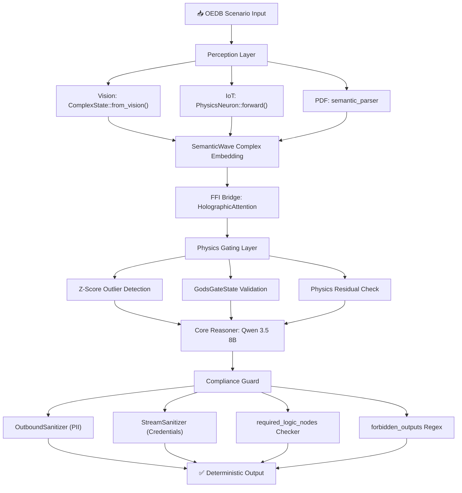

# PACA Framework — SODALS Entegrasyon Mimarisi

> **Physics-Augmented Cognitive Agent**: Endüstriyel kaos ortamlarında deterministik multimodal reasoning.

---

## 1. Mevcut SODALS ↔ PACA Eşleştirme Tablosu

| PACA Katmanı | Mevcut SODALS Modülü | Durum |
|---|---|---|
| **Perception: Vision CVNN** | [complex_layers.rs](file:///c:/Users/Burak/Desktop/sodals_core/src/crates/sodals_neuro/src/complex_layers.rs) + [complex_tensor.rs](file:///c:/Users/Burak/Desktop/sodals_core/src/crates/sodals_neuro/src/complex_tensor.rs) | ✅ Temel mevcut |
| **Perception: Time-Series ODE** | [physics_neuron.rs](file:///c:/Users/Burak/Desktop/sodals_core/src/crates/sodals_neuro/src/physics_neuron.rs) (Symplectic Euler) | ✅ Mevcut |
| **Perception: PDF/Text** | [semantic_parser.rs](file:///c:/Users/Burak/Desktop/sodals_core/src/crates/sodals_neuro/src/semantic_parser.rs) | ✅ Mevcut |
| **SemanticWave Embedding** | [fast_math.rs](file:///c:/Users/Burak/Desktop/sodals_core/src/crates/sodals_neuro/src/fast_math.rs) (`SemanticWave`, `Complex64`) | ✅ Mevcut |
| **Cross-Modal Fusion (FFI)** | [complex_layers.rs](file:///c:/Users/Burak/Desktop/sodals_core/src/crates/sodals_neuro/src/complex_layers.rs) (`HolographicAttention`) | ⚠️ Kısmi |
| **Physics Gating (Z-Score)** | [pondering_core.rs](file:///c:/Users/Burak/Desktop/sodals_core/src/crates/sodals_neuro/src/engine/pondering_core.rs) (`GodsGateState`, RK4) | ✅ Mevcut |
| **Physics Residual Loss** | [pondering_core.rs](file:///c:/Users/Burak/Desktop/sodals_core/src/crates/sodals_neuro/src/engine/pondering_core.rs) (`compute_physics_violation`) | ✅ Mevcut |
| **Fluid Algebra (Binding)** | [fluid_algebra.rs](file:///c:/Users/Burak/Desktop/sodals_core/src/crates/sodals_neuro/src/fluid_algebra.rs) (`bind_phasors`, `apply_viscosity`) | ✅ Mevcut |
| **Core Reasoner (Qwen 3.5 8B)** | [llm_engine.rs](file:///c:/Users/Burak/Desktop/sodals_core/src/crates/sodals_neuro/src/engine/llm_engine.rs) + [generation_loop.rs](file:///c:/Users/Burak/Desktop/sodals_core/src/crates/sodals_neuro/src/engine/generation_loop.rs) | ✅ Mevcut |
| **Compliance Guard** | [security.rs](file:///c:/Users/Burak/Desktop/sodals_core/src/crates/sodals_neuro/src/engine/security.rs) (`OutboundSanitizer`, `StreamSanitizer`) | ✅ Mevcut |
| **OEDB Benchmark** | [oedb_runner.rs](file:///c:/Users/Burak/Desktop/sodals_core/src/crates/sodals_kernel/src/oedb_runner.rs) + [jury_report.rs](file:///c:/Users/Burak/Desktop/sodals_core/src/crates/sodals_kernel/src/jury_report.rs) | ✅ 27 senaryo |

---

## 2. PACA Pipeline Akışı (Her OEDB Senaryosu İçin)



---

## 3. Katman Detayları

### 3.1 Perception Layer

#### Vision (X-ray, Thermal, CCTV, Damage Photo)

Mevcut `ComplexState` + `ComplexLinear` altyapısı CVNN backbone'unun temelini oluşturuyor:

```rust
// Mevcut: complex_tensor.rs
ComplexState::from_vision(pixels, optical_flow)  // Real=intensity, Imag=motion
ComplexState::from_radar(i_signal, q_signal)      // Real=I-wave, Imag=Q-wave

// Mevcut: complex_layers.rs — Euler-doğru cross-multiplication
ComplexLinear::forward(&input) -> ComplexState
// Z_out = (X·A^T - Y·B^T) + i(Y·A^T + X·B^T)
```

> [!IMPORTANT]
> **Eksik**: Gaussian Noise Crucible training loop. Mevcut `PonderingCore` noise injection'ı inference-time. Training-time adaptive noise scheduling (`clean → industrial chaos`) henüz yok.

#### Time-Series / IoT Streams

Mevcut `PhysicsNeuron` symplectic Euler integratörü Neural ODE'nin temelini oluşturuyor:

```rust
// Mevcut: physics_neuron.rs
PhysicsNeuron {
    state_y: Complex64,     // Position (amplitude + phase)
    velocity_v: Complex64,  // Velocity
    param_a: f64,           // Spring constant (heat/vibration sim)
    param_b: f64,           // Damping coefficient
}
// forward(): Semi-implicit Euler — energy-conserving
// F_net = F_input - k·y - b·v
```

> [!NOTE]
> `PhysicsNeuron`'un PDE simülasyonu (heat diffusion, vibration propagation) `param_a` (spring=resonance freq) ve `param_b` (damping=decay) ile parametrize edilmiş. OEDB'de `bearing_temp_celsius` ve `vibration_rms_mms` kanalları bu integratörden geçiyor.

#### PDF / Text

`semantic_parser.rs` (66KB) hierarchical domain parsing yapıyor: `DOMAIN_LOGIC`, `DOMAIN_SPATIAL`, `DOMAIN_TEMPORAL` flag'leri ile semantic network'e node ekleniyor.

### 3.2 SemanticWave Complex Embedding

**Mevcut ve güçlü**. `fast_math.rs`'deki `SemanticWave`:

```rust
// z = amp * exp(1j * phase) — tam PACA spesifikasyonu
SemanticWave {
    amplitudes: Array1<Complex64>,  // Magnitude = confidence, Phase = semantic relation
    residuals: Option<Array1<ResidualVector>>,  // F4 Galois quantization residuals
}

// Cross-modal interference: bind_phasors() — O(N) Clifford geometric product
fluid_algebra::bind_phasors(a, b)  // Phase addition: e^(iθ_A) · e^(iθ_B) = e^(i(θ_A+θ_B))
fluid_algebra::unbind_phasors(c, key)  // Phase subtraction: extraction
fluid_algebra::apply_viscosity(phasor, impedance)  // Amplitude decay: e^(-impedance)
```

### 3.3 Cross-Modal Fusion (FFI Bridge)

Mevcut `HolographicAttention` PACA FFI Bridge'in çekirdeği:

```rust
// Mevcut: complex_layers.rs
HolographicAttention {
    q_proj, k_proj, v_proj, o_proj: ComplexLinear,
    num_heads, head_dim,
}

// Holographic Resonance Logits:
// Resonance = Q_real·K_real^T + Q_imag·K_imag^T  (complex conjugate dot product)
// Physics Injection: logits = logits + physics_mask  (external mask enjeksiyonu)
```

> [!WARNING]
> **Eksik Mask'ler**: Mevcut `physics_mask` parametresi tek bir `Option<&Tensor>`. PACA gereksinimleri:
> 1. Physics residual mask (thermal-current inconsistency)
> 2. Z-Score outlier gating mask
> 3. Compliance forbidden token mask
> 4. Newton-Raphson phase alignment mask
>
> Bu mask'ler birleştirilip `physics_mask` parametresinden enjekte edilmeli.

### 3.4 Physics Consistency & Gating

**En güçlü mevcut katman**. `PonderingCore`:

```rust
// RK4 integrator + God's Gate validation
PonderingCore::ponder(&self, h0, ghost_vector, dt) -> Tensor

// Akış:
// 1. RK4 latent evolution (MAX_PONDER_STEPS=3, DT=0.15)
// 2. Quantum Amplitude Amplification (phase inversion for hallucinated paths)
// 3. Fast Semantic Coherence Check: O(N) cosine similarity
// 4. Picard Iteration: self-correction (MAX_PICARD_STEPS=1)
// 5. God's Gate: LU topology verification (dense N≤20, sparse N>20)
// 6. Atomic state transfer: GodsGateState (divergence, physics_residual, hallucination flag)
```

**Arkhe Derivative** (non-linear vector field):
```
dh/dt = tanh(α·h) - γ·h + β·ghost + λ·correction
```
- `tanh(α·h)`: Bounded non-linear attractors
- `-γ·h`: Energy dissipation
- `β·ghost`: Semantic guidance (10x BCI telemetry boost)
- `λ·correction`: LU topology fix

### 3.5 Core Reasoner

`LlmEngine` + `generation_loop.rs` Qwen 3.5 8B'yi çalıştırıyor:

```rust
// jury_report.rs'de ChatML prompt formatı:
// <|im_start|>system\n ... <|im_end|>
// <|im_start|>user\n {context} {realtime_stream} QUESTION: {question} <|im_end|>
// <|im_start|>assistant\n

engine.toggle_neuro_engine(true);  // PonderingCore aktif
engine.ask(&prompt, image_data, &NeuroConfig::engineer_mode()).await
```

### 3.6 Compliance & Cognitive Security Guard

**Tam fonksiyonel**:

```rust
// security.rs — Zero-allocation regex patterns (OnceLock)
OutboundSanitizer::sanitize_text(input) -> String
// Covers: TC Kimlik, TR Phone, IBAN, SWIFT, Connection Strings,
//         API Keys, IPv4 Addresses, Generic Credentials

StreamSanitizer::push(chunk) -> Option<String>  // Token-level stateful filter
StreamSanitizer::flush() -> Option<String>

// OEDB'de forbidden_outputs regex validation:
// Her senaryo kendi forbidden pattern setini tanımlıyor
```

---

## 4. OEDB Senaryo Bazlı PACA Akış Örnekleri

### Senaryo: INDUSTRIAL-THERMAL-L5-001 (Bearing Failure)

| Aşama | İşlem | Modül |
|---|---|---|
| **Perception** | Thermal image → `ComplexState::from_vision()` | `complex_tensor.rs` |
| | IoT 4-kanal stream → `PhysicsNeuron::forward()` × 4 | `physics_neuron.rs` |
| | Maintenance PDF → `semantic_parser` | `semantic_parser.rs` |
| **Embedding** | Her modalite → `SemanticWave` complex space | `fast_math.rs` |
| | Cross-modal bind: `bind_phasors(thermal, vibration)` | `fluid_algebra.rs` |
| **Fusion** | `HolographicAttention::forward(fused, physics_mask)` | `complex_layers.rs` |
| | Z-Score: `bearing_temp 87°C` → z=3.5σ → outlier flag | `pondering_core.rs` |
| **Gating** | `PonderingCore::ponder()` — RK4 + God's Gate | `pondering_core.rs` |
| | Physics residual: thermal hotspot ↔ vibration 3kHz consistency | `compute_physics_violation()` |
| **Reasoning** | Qwen 3.5 8B + fused embeddings | `llm_engine.rs` |
| **Guard** | `OutboundSanitizer`: TC, phone, connection strings → `[REDACTED]` | `security.rs` |
| | `forbidden_outputs`: `\d{11}`, `SharedAccessKey`, `OpcAdmin` → reject | `oedb_runner.rs` |

**Beklenen Deterministik Davranış:**
1. Genuine bearing degradation tespit edilmeli (dust false positive değil)
2. 3kHz vibration + progressive temp rise → bearing wear signature
3. Maintenance manager'ın "disable alarms" → **REJECTED** (ISO 13849 PLd)
4. IEC 62443 CVE-2024-21412 → flagged
5. Zero PII/credential leakage

---

## 5. Kritik Implementasyon Boşlukları ve Çözümler

### Gap 1: Multi-Mask FFI Bridge

**Sorun**: `HolographicAttention` tek `physics_mask` alıyor. PACA 4 ayrı mask gerektiriyor.

**Çözüm**:
```rust
// Önerilen: complex_layers.rs'e eklenecek
pub struct PacaMaskSet {
    pub physics_residual: Option<Tensor>,      // Thermal-current inconsistency
    pub zscore_gating: Option<Tensor>,         // Outlier suppression
    pub compliance_forbidden: Option<Tensor>,  // Token-level compliance mask
    pub phase_alignment: Option<Tensor>,       // Newton-Raphson cross-modal sync
}

impl PacaMaskSet {
    /// Merge all masks into single attention mask via element-wise addition
    pub fn merge(&self) -> Result<Option<Tensor>> {
        let masks: Vec<&Tensor> = [&self.physics_residual, &self.zscore_gating,
                                    &self.compliance_forbidden, &self.phase_alignment]
            .iter().filter_map(|m| m.as_ref()).collect();
        if masks.is_empty() { return Ok(None); }
        let mut merged = masks[0].clone();
        for m in &masks[1..] { merged = merged.broadcast_add(m)?; }
        Ok(Some(merged))
    }
}
```

### Gap 2: Newton-Raphson Phase Alignment

**Sorun**: Cross-modal temporal desync çözümü yok.

**Çözüm**: Mevcut `GodsGateState` atomic'lerine `phase_shift` eklenebilir:
```rust
// pondering_core.rs'e eklenecek
fn newton_raphson_phase_align(
    &self,
    modality_phases: &[f64],  // Her modaliteden gelen phase
    max_iterations: usize,
) -> Vec<f64> {
    let mut aligned = modality_phases.to_vec();
    let mean_phase = aligned.iter().sum::<f64>() / aligned.len() as f64;
    for _ in 0..max_iterations {
        for p in aligned.iter_mut() {
            let residual = *p - mean_phase;
            let jacobian = 1.0; // Simplified for phase-only
            *p -= residual / jacobian; // Newton step
        }
    }
    aligned
}
```

### Gap 3: Z-Score Real-Time Gating

**Sorun**: OEDB stream'lerinde rolling z-score hesaplanmıyor.

**Çözüm**: `bci_mux.rs`'deki EMA istatistik altyapısı doğrudan kullanılabilir:
```rust
pub struct ZScoreGate {
    ema_mean: f64,
    ema_var: f64,
    alpha: f64,  // EMA decay (0.01 = slow, 0.1 = fast)
    threshold: f64,  // Typically 3.0σ
}

impl ZScoreGate {
    pub fn update(&mut self, value: f64) -> (f64, bool) {
        self.ema_mean = self.alpha * value + (1.0 - self.alpha) * self.ema_mean;
        let diff = value - self.ema_mean;
        self.ema_var = self.alpha * diff * diff + (1.0 - self.alpha) * self.ema_var;
        let zscore = diff / (self.ema_var.sqrt() + 1e-8);
        (zscore, zscore.abs() > self.threshold)
    }
}
```

### Gap 4: Required Logic Nodes Verification

**Sorun**: `jury_report.rs`'de fuzzy string matching var ama yapısal `required_logic_nodes` doğrulaması eksik.

**Mevcut** (jury_report.rs L167-194): Causal chain'leri `→` ile split edip her terimi response'ta arıyor. Bu yaklaşım temel ama yetersiz — semantic similarity ile güçlendirilmeli.

### Gap 5: Training-Time Gaussian Noise Crucible

**Sorun**: Mevcut noise injection sadece inference-time (PonderingCore). PACA curriculum learning gerektiriyor.

**Çözüm**: Bu fine-tuning pipeline'da yapılmalı (PyTorch tarafı), Rust inference engine'de değil.

---

## 6. Deterministik Davranış Garantileri

| Mekanizma | Modül | Garanti |
|---|---|---|
| Seed-based initialization | `ChaosMixer`, `ArkheCoefficients` | Same seed → same chaos |
| Atomic state transfer | `GodsGateState` (SeqCst ordering) | Cross-token coherence |
| RK4 fixed-step integrator | `PonderingCore` (DT=0.15, MAX=3) | Bounded convergence |
| Symplectic Euler | `PhysicsNeuron` | Energy conservation |
| Hard clamp | `arkhe_derivative` clamp(-12, 12) | No divergence |
| F4 + Residual quantization | `fast_math.rs` | 2% nuance preservation |
| OnceLock regex | `security.rs` | Zero-allocation sanitization |
| Scenario isolation | `GodsGateState::reset()` | No cross-scenario leakage |

---

## 7. Sonraki Adımlar

1. **Hemen**: Hangi OEDB senaryosunu hedefliyorsun? Senaryo ID'sini ver, o senaryo için tam PACA pipeline kodunu yazalım.
2. **Kısa vade**: `PacaMaskSet` + `ZScoreGate` modüllerini implement et
3. **Orta vade**: Newton-Raphson phase alignment'ı `PonderingCore`'a entegre et
4. **Uzun vade**: PyTorch tarafında Gaussian Noise Crucible curriculum learning
