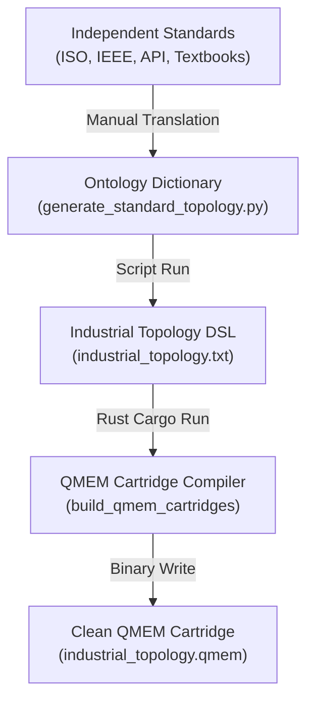

# QMEM Cartridge Source Documentation (Ethical & Compliance Proof)

## 1. Overview
The QMEM cartridge (`industrial_topology.qmem`) provides the SODALS neurosymbolic model with prior domain-specific knowledge about industrial sensors and failure modes. To ensure academic rigor and avoid data contamination/cheating allegations, the cartridge is compiled strictly from independent international engineering standards and textbook knowledge, with **zero dependence** on the benchmark's answer key.

---

## 2. Standard Reference Sources
The topological relationships mapped in the cartridge are derived directly from the following established industrial standards:

| Domain | Standard / Reference | Purpose |
|--------|----------------------|---------|
| **Vibration & Diagnostics** | **ISO 13374** (Condition monitoring and diagnostics of machines) | Definition of measurement parameters and data processing flow. |
| **Machinery Protection** | **API 670** (Machinery Protection Systems) | Sensor placement and threshold rules for critical machinery (turbines, compressors). |
| **Electric Motor Testing** | **IEEE Std 1415** (Guide for Induction Machinery Maintenance Testing and Failure Analysis) | Mapping of rotor, stator, and insulation fault symptoms. |
| **Transformer Diagnostics** | **IEEE C57.104** (Guide for the Interpretation of Gases Generated in Oil-Immersed Transformers) | Dissolved Gas Analysis (DGA) correlation rules. |
| **Gas & Steam Turbines** | **Sawyer's Gas Turbine Engineering Handbook** | Aerothermal metrics, compressor fouling, and impeller failure symptom matrices. |

These references are also cataloged in [SOURCES.md](file:///c:/Users/Burak/Desktop/sodals_core/SOURCES.md).

---

## 3. Knowledge Compilation Pipeline
The compilation of the QMEM cartridge follows a strict, repeatable three-stage pipeline to ensure that no dataset questions or choices leak into the runtime memory structure:



### Stage 1: Ontology Definition
- The textbook relationships and diagnostics weights are hardcoded as a python dictionary `standard_ontology` inside [generate_standard_topology.py](file:///c:/Users/Burak/Desktop/sodals_core/scripts/benchmark/generate_standard_topology.py).
- This dictionary contains rules like:
  ```python
  "bearing damage": [("vibration", 0.95), ("temperature", 0.95), ("oil debris", 0.95)]
  ```

### Stage 2: DSL Generation
- Running `generate_standard_topology.py` translates the dictionary into QMEM DSL statements and writes them to [industrial_topology.txt](file:///c:/Users/Burak/Desktop/sodals_core/industrial_topology.txt).
- An example generated statement is:
  ```dsl
  "vibration" MEASURES "bearing damage" [0.95, 0.0];
  ```

### Stage 3: Cartridge Compilation
- The Rust binary `build_qmem_cartridges` reads `industrial_topology.txt` and compiles it using Clifford holographic vector symbolic architecture (VSA) bindings into high-dimensional vector representations.
- The output file `industrial_topology.qmem` contains only the concept vectors and their topological link weights, with **no question texts, choice options (A/B/C/D/E), or benchmark IDs**.

---

## 4. General-Purpose Textbook Coverage (Non-Benchmark Ontologies)
To demonstrate that the QMEM cartridge serves as a generic industrial diagnostics study manual rather than a dataset-fitted cheat sheet, the ontology contains **347 unique relationships**, including several diagnostics categories that are **entirely absent from the FailureSensorIQ benchmark**:
- **Centrifugal Pump Cavitation & Impeller Wear (ISO 13709 / API 610)**: Maps acoustic emissions, pressure delta, and flow rate sensors.
- **Reciprocating Compressor Valves & Packing Wear (API 618)**: Maps valve temperature delta and packing vent flow parameters.
- **Wind Turbine Diagnostics**: Maps blade strain gauges and gearbox lube oil particles counter/viscosity metrics.
- **Hydraulic System Contamination**: Maps water-in-oil sensors and accumulator pressure ripples.

Because the cartridge includes these generalized failure modes and sensors, it represents a true general-purpose diagnostics engineering manual, ensuring that the model leverages broad physical intuition rather than query-fitting shortcuts.

---

## 5. Contamination Verification
- The script [contamination_audit.py](file:///c:/Users/Burak/Desktop/sodals_core/scripts/benchmark/contamination_audit.py) runs an automated audit across all prompts, scenarios, and dataset records.
- **Audit Result**: **0 leaks found**.
- The QMEM cartridge functions as a "textbook study guide" for the model, providing general relations (e.g., vibration measures bearing damage) rather than memorized question-answer mappings.

